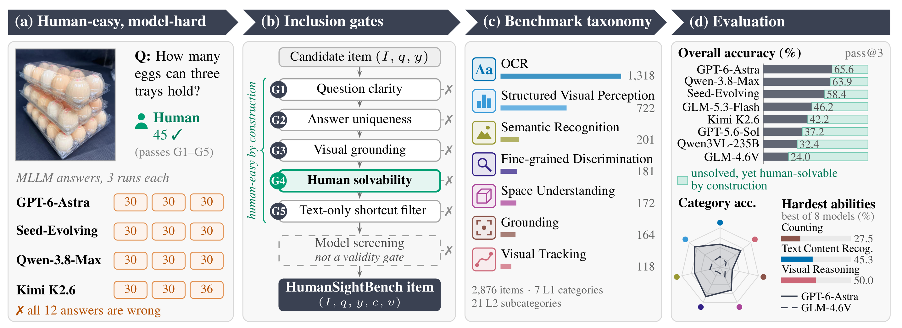

# HumanSightBench

**A Benchmark for Human Visual Perception in MLLMs**

Can multimodal models see what humans see? HumanSightBench tests visual questions that are **human-easy by construction and model-hard by evaluation**, from counting objects and following lines to reading noisy text. Across the eight models evaluated in the paper, the best overall pass@3 is **65.6%**, and no model exceeds **27.5%** on Counting.

[Paper](https://arxiv.org/abs/2611.12305) | [PDF](https://arxiv.org/pdf/2611.12305) | [Dataset link from the paper](https://huggingface.co/datasets/Susan0803/visual-perception-benchmark-anon) | [BibTeX](CITATION.bib)

| Visual questions | Top-level categories | Fine-grained abilities | Inclusion gates |
| ---: | ---: | ---: | ---: |
| 2,876 | 7 | 21 | 5 |



*Figure 1 from Zixin Su et al., [HumanSightBench, arXiv:2611.12305v1](https://arxiv.org/pdf/2611.12305v1#page=2) (2026), [CC BY 4.0](https://creativecommons.org/licenses/by/4.0/). Cropped from the original PDF; scientific content is unchanged. The example illustrates a visual failure, not an estimate of everyday model reliability.*

## What Makes It Different

Every retained item must pass five checks: **question clarity, answer uniqueness, visual grounding, human solvability, and text-only shortcut filtering**. Three annotators must independently answer correctly under the paper's human-validation protocol. Model screening then removes saturated items; model failure alone is not an inclusion criterion.

The seven categories are Grounding, Semantic Recognition, Fine-grained Discrimination, Visual Tracking, Space Understanding, OCR, and Structured Visual Perception. The 21 ability groups make it possible to diagnose specific bottlenecks instead of relying only on an aggregate score. See [Section 3 and Appendix A](https://arxiv.org/pdf/2611.12305v1) for the construction protocol and taxonomy.

## Results

**Paper-reported results, not an independent rerun.** Values below are pass@3 (%): a question counts as solved if at least one of the first three responses is judged correct. This is **not single-attempt accuracy**.

| Model | Overall pass@3 (%) | Counting pass@3 (%) |
| --- | ---: | ---: |
| GPT-6-Astra | **65.6** | **27.5** |
| Qwen-3.8-Max | 63.9 | 22.9 |
| Seed-Evolving | 58.4 | 26.0 |
| GLM-5.3-Flash | 46.2 | 15.3 |
| Kimi K2.6 | 42.2 | 13.0 |
| GPT-5.6-Sol | 37.2 | 10.7 |
| Qwen3VL-235B-Thinking | 32.4 | 8.4 |
| GLM-4.6V | 24.0 | 4.6 |

Source: [Table 1, arXiv v1, page 7](https://arxiv.org/pdf/2611.12305v1#page=7). The best overall model still leaves 34.4% of these human-validated items unsolved across three attempts.

**Reading the scores:** Models use the paper's different Resize / No Resize input settings, while human annotators can zoom and pan. These are model-input configuration comparisons, not a controlled human-versus-model viewing experiment. OCR and Structured Visual Perception account for 70.9% of the dataset, so overall scores reflect that mix. See Sections 4.1 and 5 and Appendix B for evaluation details and limitations.

## Resources And Status

- **Paper:** [arXiv:2611.12305](https://arxiv.org/abs/2611.12305), first submitted on November 9, 2026. The results on this page correspond to v1.
- **Dataset:** [Susan0803/visual-perception-benchmark-anon](https://huggingface.co/datasets/Susan0803/visual-perception-benchmark-anon) is the link provided in the paper. Public download availability was not verified on November 11, 2026.
- **Repository:** This release provides the paper overview, its source figure, and citation. It does not include evaluation code or a dataset copy.

The paper and reproduced figure are licensed under CC BY 4.0. This does not establish a license for any separate dataset or future code release. Figure provenance is recorded in [assets/provenance.json](assets/provenance.json).

## 中文速览

**人能看懂的图，多模态模型真的看懂了吗？** HumanSightBench 收录了 2,876 道短答案视觉题，覆盖 7 大类、21 项细分能力，通过五项纳入检查减少歧义、非视觉线索等干扰。论文评测的 8 个模型中，最高整体 pass@3 为 65.6%，计数任务最佳仅为 27.5%。

这里的 pass@3 指三次回答中至少一次正确，不是单次准确率；人类与模型的图像查看条件也不完全一致。这个基准更适合定位具体视觉能力短板，而不是仅凭总分判断日常可靠性。

## Citation

If HumanSightBench is useful to your work, consider starring this repository and citing the paper:

```bibtex
@misc{su2026humansightbench,
  title = {{HumanSightBench}: A Benchmark for Human Visual Perception in {MLLMs}},
  author = {Zixin Su and Yangguang Lin and Zegang Peng and Yuntong Sun and
            Xuanyi Wang and Jiahao Wang and Qiankai Xu and Bing Yuan and
            Jinze Bai and Youbin Wu and Jingjia Huang and Ruyang Liu and Yanxu Hu},
  year = {2026},
  eprint = {2611.12305},
  archivePrefix = {arXiv},
  primaryClass = {cs.CV},
  url = {https://arxiv.org/abs/2611.12305}
}
```
